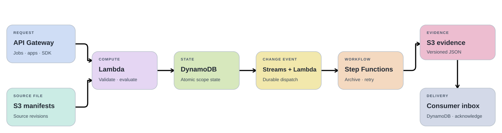

# AfterZero

**A passed data check has a lifetime.** AfterZero is a serverless validity service for zero-result checks. It records what was checked, whether required producers completed their inputs, and which later changes undermine the conclusion.

A daily validation job finds zero invalid rows and publishes a report. A late file then adds an invalid record to yesterday's batch. AfterZero revokes the original receipt, identifies the contradicting record, and delivers a versioned evidence snapshot to the consumer inbox. Another customer's report remains unaffected.

This repository contains the working state machine, authenticated HTTP service, live browser demo, Python SDK, S3 manifest adapter, evidence workflow, infrastructure template, and tests. All demo data is synthetic. No AI inference is used to determine correctness.

## What runs

| Component | Responsibility |
|---|---|
| API Gateway HTTP API | HTTPS endpoints; request throttling |
| Lambda | Input validation, typed predicate evaluation, receipt state, manifest ingestion |
| DynamoDB on-demand | Conditional per-scope writes, source revisions, receipts, credentials and inbox |
| DynamoDB Streams + Lambda | Dispatch a workflow from the same committed item as the state change |
| Step Functions Standard | Archive evidence and deliver it to the consumer inbox, with retries |
| S3 | Durable input manifests and versioned evidence snapshots |
| SQS + EventBridge | Capture exhausted dispatch/manifest retries and workflow failures |



There is no dedicated server, daemon, scheduled data-quality scan, or required CI/CD runner. The SAM template is deployed through CloudFormation with a manual script. Inactive workloads retain storage but perform no scheduled validation. Storage, logs and active requests incur costs; runtime/dependency updates and failure handling remain normal software responsibilities.

## Run tests

```sh
python3.12 -m venv .venv
.venv/bin/pip install -r requirements-dev.txt
.venv/bin/pytest -q
```

The pure model tests cover coverage gates, late records, registration races, duplicates, conflicting identifiers, out-of-order revisions, expiry, coarse changes, scope isolation, type semantics, and 100 randomized event sequences compared with a full append-only reevaluation oracle.

## Deploy to your AWS account

Requires Python 3.12+, configured AWS credentials and permission to create the resources in `template.yaml`. Deploy into an account you control.

```sh
AWS_REGION=ap-south-1 .venv/bin/python scripts/deploy.py
```

The script packages source and static assets, uploads the package to a private artifact bucket, and creates/updates the SAM-transformed CloudFormation stack. It stores outputs and a generated owner token under the gitignored `.deploy/` directory. It never prints that token. `AFTERZERO_STACK` optionally changes the stack name; choose a valid lowercase S3-compatible name.

The owner token is a deployment secret. Use `POST /api/credentials` to issue shorter-lived integration tokens restricted to named scopes and producer identities. Never put the owner token in browser source, a public URL, a repository, or a video.

After deployment:

```sh
.venv/bin/python scripts/smoke.py
```

This writes isolated synthetic test scopes and verifies real AWS behavior. `docs/live-verification.json` is generated only after the checks pass.

## Try the live workspace

[Open AfterZero](https://z8qah1zgdd.execute-api.ap-south-1.amazonaws.com/). “Try it live” creates two isolated customer scopes, with actual reference-evaluator checks over synthetic projected records. Public sessions expire after one hour and cannot create additional scopes or issue credentials. Anonymous provisioning is capped at 300 sessions per UTC day, and API Gateway throttles requests.

1. Both checks report zero failures but wait for a required producer.
2. Complete both inputs: the receipts become covered through their named revisions.
3. Export the JSON report, including its receipt and status endpoint. No token is exported.
4. Deliver a late invalid row through a real S3 object notification. Customer A is revoked; B is unchanged.
5. Replay the event: the operation is an idempotent no-op.
6. Deliver revision 3 before revision 2 for customer B: status becomes unknown.
7. Fill the gap: the buffered revision is applied and B's coverage returns.
8. Inspect S3 evidence and acknowledge a durable inbox delivery.

## Integrate an existing job

`afterzero_client.py` uses only Python's standard library. Other languages can use the same JSON API.

```python
from afterzero_client import Client

client = Client(service_url, integration_token)
client.observe(
    scope="customer-A",
    receipt_id="daily-check-v1",
    artifact="daily-report-v1",
    observed_count=0,
    basis={"uploader": 1, "validator": 1},
    predicate={"all": [{
        "field": "validation_status", "op": "eq", "value": "invalid"
    }]},
)
state = client.scope("customer-A")
```

For a complete example, run `scripts/sqlite_example.py` with `AFTERZERO_URL` and `AFTERZERO_TOKEN` set locally. It executes a real SQL check in SQLite, registers the zero result, inserts a backdated invalid row, publishes its S3 manifest, and observes revocation through the deployed API.

Reliability requires a durable source integration. Couple source publication to a revision manifest or an existing transactional outbox. A best-effort HTTP call after committing a database transaction is insufficient. This repository supplies HTTP, Python and S3 integrations; it does not include automatic dbt or arbitrary CDC connectors.

## Contract and semantics

See [API reference](docs/api.md).

- A scope is one dataset partition with a fixed set of required producers.
- Each producer supplies application revision integers starting at 1. Revisions must be contiguous; native database LSNs need an adapter and must not simply be treated as these integers.
- An observation carries the source revision vector it actually read. Changes after that vector are replayed before a status is returned. The conditional DynamoDB update serializes registration with concurrent changes.
- The generic observation endpoint records a **producer attestation** that the initial result was zero. It does not prove that the producer ran its query correctly.
- `/check` independently evaluates supported predicates against the bounded stored append-only projections, and registers a receipt only if no row matches. Its evidence mode is `service_evaluated_projection`.
- Predicates support 1–8 conjunctive terms: `eq`, `in`, integer `gte`, integer `lt`. Missing fields differ from explicit null. Booleans differ from integers. Range values may use integer epoch seconds for time. Floating point and arbitrary SQL are unsupported.
- `append` events carry projected row values sufficient for the predicate. A matching row after the observation basis revokes the receipt. A `changed` event represents a coarse update/deletion/rewrite and requires source reevaluation. `seal` declares completion; `reopen` withdraws coverage and revokes affected earlier receipts.
- Completeness is supplied by authorized producers; it is not inferred from silence or an object count.
- A receipt means unchanged **through the named source checkpoints**, not globally current or guaranteed against an unseen future event.
- Revocation is terminal for an old receipt. A new evaluation uses a new receipt ID. Expiry is checked on reads and does not depend on DynamoDB TTL deletion timing.
- Evidence snapshots describe status at their recorded evaluation time. Consumers must use the live status endpoint before reuse and must not treat an archived green snapshot as current status.
- SHA-256 detects a mismatch relative to trusted material; it is not a signature, proof of authorship, or proof that source assertions were true.

## Bounded operating envelope

This implementation deliberately bounds a scope so one conditional write can atomically update state and workflow intent:

- Up to 8 producers, 128 events, and 32 receipts per scope.
- At most 25 projected rows per event; 16 scalar fields per row; 12KB normalized event size.
- Maximum state JSON size 170KB; larger scopes must be split or use coarse change events.
- Out-of-order buffer permits a gap of up to 32 application revisions.
- Lifetime up to 7 days; UI sessions last 1 hour. State cleanup is eventual; access expiry is immediate on reads.
- Scope list returns at most 50 scopes; direct lookup remains available for known IDs. Inbox returns at most 100 messages in scope/version sort order, not global time order.
- Evidence/input objects expire after 30 days; inbox messages after 7 days. Retention is configurable in the template/code.

The engine is suitable for bounded batch partitions and projected change records. It is not a warehouse replacement or an unlimited row-stream processor. Arbitrary joins, UDFs, multi-source global transactions, automated downstream rebuilds, and push webhooks are not implemented. Consumers use the durable inbox and status endpoints.

## Failure recovery and operations

DynamoDB state and workflow intent are persisted in the same item. Stream dispatch uses deterministic Step Functions execution names, and inbox insertion is conditional so replay cannot reset an acknowledgement. Manifest failures and exhausted stream retries go to the failure queue. Failed workflow executions are also forwarded there through EventBridge.

Inspect failed executions in Step Functions and use its supported redrive operation after resolving the cause. Inspect queued manifest/dispatch failures before replaying them. Duplicate valid events are safe; conflicting IDs are rejected. There is no claim that retries fix malformed input or unavailable external systems automatically.

To remove the deployment, first retain any evidence you need. The data bucket must be emptied before deleting the CloudFormation stack; the separate artifact bucket is also owned by this deployment. Cleanup is intentionally not automatic. Never run destructive cleanup against a shared bucket.

## Prior art and originality

AfterZero applies established work on negative provenance, query completeness, and query-result invalidation. Its contribution is the implemented portable receipt lifecycle, coverage behavior, source adapter boundary, and serverless deployment—not an assertion that these algorithms were invented here.

- [Zhang and Jagadish, Provenance in Dynamic Data Systems, TaPP 2011](https://www.usenix.org/legacy/event/tapp11/tech/final_files/Zhang.pdf)
- [Razniewski and Nutt, Completeness of Queries over Incomplete Databases, PVLDB 2011](https://www.vldb.org/pvldb/vol4/p749-razniewski.pdf)
- [Oracle Continuous Query Notification](https://docs.oracle.com/en/database/oracle/oracle-database/26/odpnt/featChange.html)
- [Braid-DB: Tracking Dubious Data](https://web.cels.anl.gov/~woz/papers/Braid-DB_2022.pdf)

Built for AWS Builder Center's **Weekend Challenge: No Pipeline, No Problem**, November 2026.
